<!--
  Astoris · GitHub profile
  operator's field notebook · paper / ink / rust
  Edit only the /NOW block for day-to-day changes.
-->

<p align="center">
  <picture>
    <source media="(prefers-color-scheme: dark)" srcset="./assets/banner-dark.svg" />
    
  </picture>
</p>

<p align="center">
  <a href="https://astoris.dev">astoris.dev</a>
  &nbsp;·&nbsp;
  <a href="mailto:AstorisTheBrave@proton.me">email</a>
  &nbsp;·&nbsp;
  UK time
</p>

<p align="center"><strong>Backend engineer growing into Site Reliability Engineering.</strong></p>
<p align="center">I build observable services, automate the repetitive parts, and learn by operating real systems.</p>

<br />

### <sub><code>01 · CURRENT SIGNAL</code></sub>

<!-- NOW:START -->
```txt
building    ->  argus - Prometheus / OpenTelemetry for discord.py (in progress)
working on  ->  Rostra - a sharded Discord service (in progress)
learning    ->  SLIs, SLOs, error budgets, incident response, and IaC
```
<!-- NOW:END -->

<sub><em>Updated by hand. “In progress” means exactly that.</em></sub>

<br />

### <sub><code>02 · RELIABILITY IN PRACTICE</code></sub>

<p align="center">
  <picture>
    <source media="(prefers-color-scheme: dark)" srcset="./assets/whoami-dark.svg" />
    
  </picture>
</p>

#### [URSA](https://github.com/greyfoundry/ursa-android) · mature / released

A native, privacy-first Android companion for Uptime Kuma. URSA turns service health into an operator-friendly signal: live monitor state, heartbeat history, multi-server support, and FOSS push notifications through UnifiedPush without Firebase or a hosted relay.

`Kotlin` · `Jetpack Compose` · `Material 3` · `Uptime Kuma` · `UnifiedPush` · `ntfy`

[Source](https://github.com/greyfoundry/ursa-android) · [Latest release](https://github.com/greyfoundry/ursa-android/releases/latest) · [Security policy](https://github.com/greyfoundry/ursa-android/security/policy)

<br />

### <sub><code>03 · OPERATIONAL TOOLKIT</code></sub>

| Signal | Services | Data | Runtime & delivery |
|---|---|---|---|
| Prometheus, OpenTelemetry, Grafana | Python, TypeScript, Go | PostgreSQL, Redis, ClickHouse | Linux, Docker, GitHub Actions |

<sub>Tools I have used in public work, not a percentage chart and not a claim of mastery.</sub>

#### The loop I am building around

| observe | define | automate | learn |
|---|---|---|---|
| Measure behaviour and make failure visible. | Turn expectations into explicit service objectives. | Remove repetitive work and make recovery repeatable. | Feed incidents, surprises, and user impact back into the system. |

<br />

### <sub><code>04 · LEARNING NEXT</code></sub>

- **SLIs, SLOs, and error budgets** - connecting user-visible reliability to engineering decisions.
- **Infrastructure as code** - reproducible environments with OpenTofu/Terraform-style workflows.
- **Incident response and runbooks** - clear detection, triage, communication, recovery, and learning.
- **Container orchestration** - building practical Kubernetes knowledge without pretending YAML is the goal.

<br />

### <sub><code>05 · OPEN SOURCE SIGNAL</code></sub>

#### GitHub metrics

<p align="center">
  <picture>
    <source media="(prefers-color-scheme: dark)" srcset="https://raw.githubusercontent.com/AstorisTheBrave/AstorisTheBrave/output/metrics-dark.svg" />
    
  </picture>
</p>

<sub>The metrics card is generated once a day and published as a static snapshot.</sub>

#### Languages across public work

<p align="center">
  <picture>
    <source media="(prefers-color-scheme: dark)" srcset="https://raw.githubusercontent.com/AstorisTheBrave/AstorisTheBrave/output/languages-dark.svg" />
    
  </picture>
</p>

<sub>The language card is generated once a day from public repository data. It describes the code, not the person.</sub>

<details>
  <summary><sub><code>after hours / contribution snake</code></sub></summary>
  <br />
  <p align="center">
    <picture>
      <source media="(prefers-color-scheme: dark)" srcset="https://raw.githubusercontent.com/AstorisTheBrave/AstorisTheBrave/output/github-snake-dark.svg" />
      
    </picture>
  </p>
</details>

<br />

### <sub><code>06 · QUOTE OF THE DAY</code></sub>

<p align="center">
  <picture>
    <source media="(prefers-color-scheme: dark)" srcset="https://raw.githubusercontent.com/AstorisTheBrave/AstorisTheBrave/output/quote-dark.svg" />
    
  </picture>
</p>

<sub>A deterministic daily note from a small curated set - no page-view API call.</sub>

<br />

### <sub><code>07 · CONTACT</code></sub>

I am working toward an SRE role and I am especially interested in observability, service ownership, automation, and the calm engineering that makes systems easier to operate.

- **Web:** [astoris.dev](https://astoris.dev)
- **Email:** [AstorisTheBrave@proton.me](mailto:AstorisTheBrave@proton.me)
- **Timezone:** UK time

<details>
  <summary><sub><code>$ man astoris</code></sub></summary>
  <br />

  ```txt
  NAME
        astoris - backend engineer following the signals toward SRE

  SYNOPSIS
        astoris [--observe] [--automate] [--learn]

  PRINCIPLES
        make failure visible
        keep recovery boring
        write down what the system taught you

  STATUS
        learning in public; shipping carefully
  ```
</details>

<br />

<p align="center">
  <sub><code>observe -&gt; define -&gt; automate -&gt; learn</code></sub>
</p>
